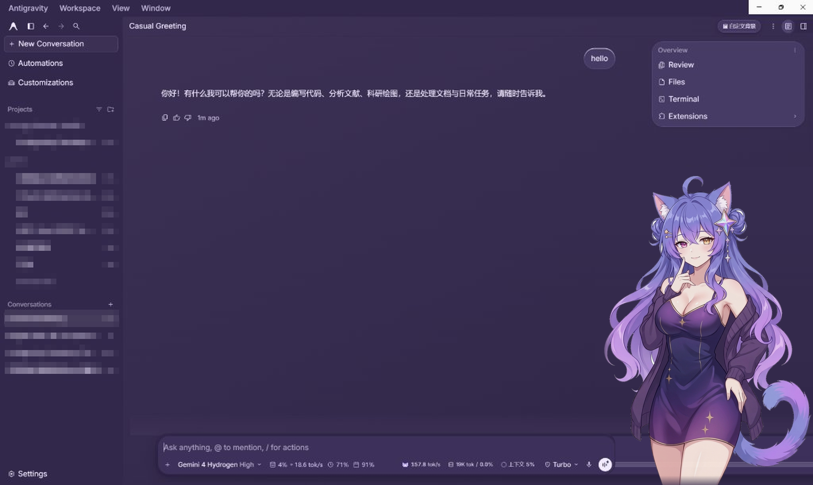
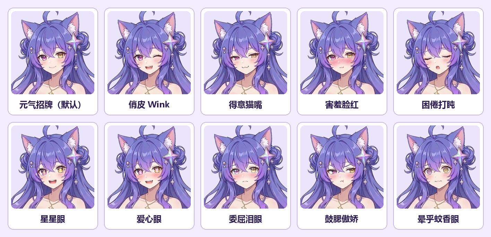
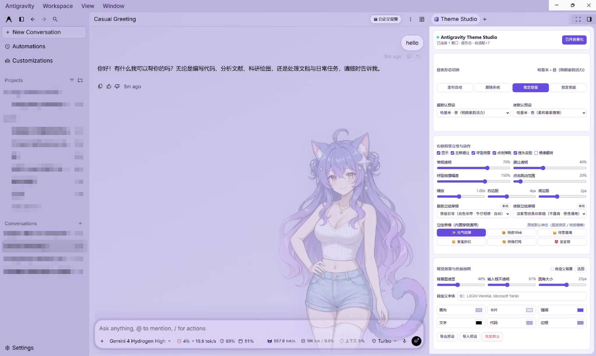

<div align="center">
  
  <h1>Antigravity Theme Studio</h1>
  <p><strong>专为 Antigravity Desktop 打造的二次元紫韵主题美化与 WebGL 动态立绘插件</strong></p>

  <blockquote>
    警告：检测到你的桌面长期被性冷淡黑灰统治，代码快乐即将跌破警戒线！装上 <strong>Antigravity Theme Studio</strong>，立刻在屏幕右下角召唤“成年版哈基米”担任首席气氛组长——白天柔雾浅紫元气监工，入夜暮紫慵懒陪肝，还能随心切换兔女郎、JK 水手服、雪纺黑丝御姐、极客卫衣、新中式旗袍、猫娘女仆与占星魔女等 16 套穿搭和 10 款高萌表情镇压满屏报错。记住：二次元的事，怎么能叫摸鱼呢？
  </blockquote>

  <p>
    
    
    
    
    <a href="LICENSE"></a>
  </p>

  <p>
    <a href="#-效果展示">效果对比</a> ·
    <a href="#-核心视觉与立绘特性">立绘与特性</a> ·
    <a href="#-快速安装">快速安装</a> ·
    <a href="#-使用方式">控制面板</a>
  </p>
</div>

---

## ✨ 效果展示

<table>
  <tr>
    <th width="50%">☀️ 昼形态 · 柔雾浅紫（白色花边兔女郎）</th>
    <th width="50%">🌙 夜形态 · 柔和暮紫（暮紫慵懒穿搭）</th>
  </tr>
  <tr>
    <td align="center"></td>
    <td align="center"></td>
  </tr>
</table>

<details>
<summary>👗 <strong>展开查看内置 16 套高清透明立绘穿搭（昼 / 夜自由混搭 · 全套通用 10 款表情）</strong></summary>
<br />

| 昼版 · 清新日常 | 夜版 · 暮紫慵懒 | 通用 · 白色花边兔女郎 | 通用 · 深紫 JK 水手服 |
| :---: | :---: | :---: | :---: |
|  |  |  |  |

| 通用 · 淡紫雪纺黑丝御姐 | 通用 · 暗黑辣妹露脐装 | 通用 · 暖冬修身毛衣裙 | 通用 · 冬日炭黑羊绒大衣 |
| :---: | :---: | :---: | :---: |
|  |  |  |  |

| 通用 · 极客猫耳耳机卫衣 | 通用 · 紫蝶新中式改良旗袍 | 通用 · 紫黑蕾丝猫娘女仆 | 通用 · 星穹占星小魔女 |
| :---: | :---: | :---: | :---: |
|  |  |  |  |

| 通用 · 青空薄荷格裙 JK | 通用 · 紫韵挂脖包臀裙 | 通用 · 辣妹热裤猫娘女仆 | 通用 · 红领结黑格 JK |
| :---: | :---: | :---: | :---: |
|  |  |  |  |

</details>

<details>
<summary>🎭 <strong>展开查看内置 10 款二次元表情差分（通用全部 16 套穿搭 · 搓头或掷骰即可变脸）</strong></summary>
<br />

<p align="center">
  
</p>

</details>

---

## 🎨 核心视觉与立绘特性

| 模块 | 核心亮点 |
| :--- | :--- |
| **WebGL 2 动态交互立绘** | 升级 WebGL 2（自动回退 WebGL 1）与 Overscan 扩边视口：锁定五官不形变，支持**胸肩微呼吸 + 猫耳/兔耳分型轻颤 + 呆毛心情弹簧 + 猫尾外弧轻摇 + 轻歪头倾听**，点击立绘任意部位触发局部果冻弹跳，鼠标完全穿透不挡字与划词。 |
| **表情混搭 & 搓头变脸** | 内置**元气招牌、俏皮 Wink、得意猫嘴、害羞脸红、困倦打盹、星星眼、爱心眼、委屈泪眼、鼓腮傲娇、晕乎蚊香眼** 10 款表情差分（`exprAnchor` 通用校准全部 16 套穿搭），支持着色器级**眼/嘴上下半脸混搭 + 渐进腮红 + 轻点头渐显**，搓头即可切换并固定。 |
| **全窗光影氛围共振** | 开启壁纸时自动采样环境主色为立绘增添柔和 **Rim Light 轮廓光**（无壁纸则随本地昼夜时段流转）；右鬓角星形发饰定期呼吸扫芒，换装支持 `340ms` 斜向星辉光幕转场。 |
| **对话默契与静默伴侣** | 轻量只读本地遥测（不传文本、不弹气泡）：联动 AI 思考/完工报喜/等你拍板歪头提醒/多子代理 `smug` 闪现/报错修复与记忆压缩；支持打字节奏耳颤与挂机打盹被抓包秒坐直。 |
| **16 套衣橱零卡顿热缓存** | 16 套穿搭端到端多图与 GPU 表达式纹理缓存，并由宿主后台解码，切皮肤与变脸全程零卡顿秒切换。 |
| **自由构图与智能避让** | 支持缩放（`0.50x–1.60x`）、右边距/底边距微调、常规透明度、**水平镜像翻转**（着色器内羽化自适应）；展开右侧面板时平滑左移并淡出避让。 |
| **昼夜双形态与 4 套预设** | 默认 `07:00–19:00` 柔雾浅紫昼版、`19:00–07:00` 柔和暮紫夜版，支持定时 / 跟随系统 / 手动锁定 / 一键还原，各预设色板独立微调互不串色。 |
| **全窗自定义画布背景** | 一键选取本地图片作为整窗背景（`10%–100%` 透显度调节），搭配毛玻璃底部输入栏、可调圆角（`4–36px`）与代码高亮配色。 |

---

## 📦 快速安装

### 方式一（推荐）：一键复制提示词给 Antigravity 自动安装

不想手动配置或敲命令时，点击代码块右上角 **Copy** 复制下面这段提示词，直接发给 Antigravity 对话即可自动完成安装或更新：

```text
请帮我安装或更新 GitHub 插件 https://github.com/happyday91/agy-theme-studio ：自动执行对应系统的一键安装脚本（Windows 运行 install.ps1，macOS/Linux 运行 install.sh）将其部署到 Antigravity 插件目录，完成后提醒我启用或重启生效。
```

<details>
<summary>💻 <strong>方式二：终端一行命令自动安装 / 更新（支持 Windows / macOS / Linux）</strong></summary>
<br />

无需手动查找插件目录；无论是否安装过 `git`，脚本都会自动克隆、拉取更新或走压缩包安装，且**不会覆盖 `sidecar_data` 个人配置**。

- **Windows（终端）**（兼容 CMD 与 PowerShell）：
  ```cmd
  powershell -NoProfile -ExecutionPolicy Bypass -Command "irm https://raw.githubusercontent.com/happyday91/agy-theme-studio/main/install.ps1 | iex"
  ```

- **macOS / Linux（终端）**：
  ```bash
  curl -fsSL https://raw.githubusercontent.com/happyday91/agy-theme-studio/main/install.sh | bash
  ```

</details>

> **启用生效**：安装完成后，在 Antigravity Desktop 的 **Plugins / Customizations** 管理页启用 **Antigravity Theme Studio**（或重启客户端即可生效）。

---

## 🛠️ 使用方式

### 1. 可视化控制面板（支持立绘智能左移避让）

在对话中打开 `[Theme Studio](sidecar://agy-theme-studio/theme_studio/)`（或在插件管理中打开面板），即可在自适应单页仪表盘中实时调节全部参数；展开面板时立绘会自动平滑左移淡出，不遮挡右侧操作：

<table>
  <tr>
    <th width="64%">整窗避让联动效果</th>
    <th width="36%">控制面板高清全览</th>
  </tr>
  <tr>
    <td align="center"></td>
    <td align="center"></td>
  </tr>
</table>

- **昼夜形态与预设**：切换定时 / 跟随系统 / 锁定昼夜 / 暂停还原，自定义起昼与起夜时间、默认昼夜预设。
- **右侧立绘与动作**：一键开关显示、左移避让、呼吸微摆、点击弹跳、搓头变脸、灵动微动态、光影氛围、对话默契、镜像翻转；滑动调节常规/避让透明度、呼吸幅度、点击跳动范围、缩放与边距，在 16 套通用内置穿搭间自由混搭或一键点击「本地」导入自定义立绘，并通过下拉选单快速切换 10 种立绘表情。
- **视觉效果与色板**：开启自定义背景与选图，调整背景透显度、输入框不透明度、圆角大小与字体；逐项微调画布/卡片/强调/文字/代码/边框颜色，支持 JSON 预设导出、导入与恢复默认。

### 2. 顶部快捷工具胶囊（3D 骰子随机换装 + 自定义背景）

- **🎲 3D 骰子盲盒换装**：「自定义背景」左侧内置一枚真实 3D 立体骰子按钮，点击后骰子抛起翻滚并随机落在 `1–6` 新点数，同时为当前形态随机切换**新穿搭与新表情**！
- **🖼 自定义背景**：点击对话窗口顶部右侧的 **「🖼 自定义背景」** 按钮即可快速开启/更换本地背景图（推荐 `16:9` 或 `16:10` 横屏图），并在面板或快捷入口调节背景透显度。

### 3. 对话自然语言指令

也可以直接用自然语言让 Antigravity 帮你秒切皮肤与表情，例如：
- “切换为夜形态主题，夜版立绘换成兔女郎”
- “把哈基米表情换成得意猫嘴（或害羞脸红 / 俏皮 Wink / 星星眼）”
- “开启搓头变脸，立绘透明度调到 0.72”
- “打开 Theme Studio 控制面板”

### 4. 作者亲测自用预设推荐

仓库根目录附带了作者自己日常导出的夜形态主题预设 [custom-night-mwngqv89.json](custom-night-mwngqv89.json)（`哈基米 · 夜（柔和暮紫慵懒）（导出）`）：
- **亲测体验**：作者长期主力自用配方，整体暮紫对比度柔和不刺眼，白天拉低亮度或深夜爆肝写代码都非常耐看、护眼又合适，搭配夜版慵懒立绘氛围感直接拉满！
- **一键导入**：在 Theme Studio 面板点击 **「导入预设」**，选中 [custom-night-mwngqv89.json](custom-night-mwngqv89.json) 即可在预设列表中立即启用，也欢迎大家到 [Issue #1 分享楼](https://github.com/happyday91/agy-theme-studio/issues/1) 晒出你的配色配方！

---

## 🎉 自由发挥 & 欢迎共创

本项目基于宽松的 MIT 协议开源——不管是塞入自己的本命立绘、爆改专属色板预设、新增更多魔性表情差分，还是直接魔改 WebGL 物理参数与交互脑洞，**欢迎大家自由发挥！** 喜欢的话欢迎点个 ⭐ Star，或直接提 Issue / PR 分享你的神仙配色和二创玩法！

---

<div align="center">
  <sub>基于 <a href="LICENSE">MIT License</a> 开源 · Made for Antigravity Desktop</sub>
</div>
