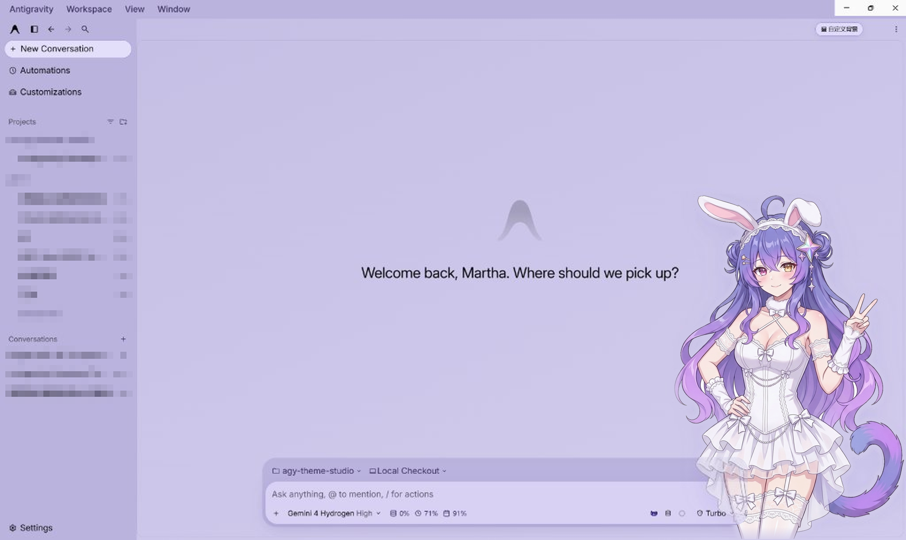

<div align="center">
  
  <h1>Antigravity Theme Studio</h1>
  <p>专为 <strong>Antigravity Desktop</strong> 打造的二次元紫韵主题美化与动态立绘插件</p>
</div>

## 效果展示

### 桌面端实机效果（昼版 · 兔女郎穿搭 / 夜版 · 暮紫穿搭）

| 昼版 · 柔雾浅紫（搭配白色花边兔女郎） |
| :---: |
|  |

| 夜版 · 柔和暮紫（搭配暮紫慵懒穿搭） |
| :---: |
|  |

---

## 核心视觉与立绘特性

### 右侧动态交互立绘（WebGL 软体物理 + 3 套内置穿搭）

- **3 套内置高清透明立绘，昼夜自由混搭**：内置 **昼版日常（纯白吊带 + 浅蓝牛仔短裤 + 白丝）**、**夜版慵懒（暮紫丝质吊带裙 + 针织开衫）** 与 **V2 白色花边兔女郎（昼夜通用）** 三套透明抠图立绘，昼夜两种主题形态可各自独立选用，也支持替换为自己的本地立绘图片。
- **待机微呼吸 & 柔风发尾微摆**：基于 WebGL `20×28` 顶点网格实时驱动，锁定面部五官不形变，仅让胸肩呈现自然呼吸起伏、外侧发梢与猫尾随柔风轻摆；幅度支持 `50%–200%` 精细调节，切换至后台或最小化时自动休眠，几乎不占性能。
- **精准透明通道命中 + 局部点击弹跳**：借助 `96×144` 透明通道命中图精确识别人物轮廓，**点击立绘任意部位即可触发局部果冻回弹**（`10%–150%` 弹跳范围可调），同时完全不遮挡、不拦截底层对话区的文字选中、链接点击与页面滚动。
- **自由位置构图 + 镜像翻转**：支持 `0.50x–1.60x` 自由缩放、右边距（`-220px ~ 360px`）与底边距（`-180px ~ 300px`）微调、常规透明度调节，以及**一键水平镜像翻转**（外层边缘柔和羽化自动同步适配）。
- **右侧栏智能平滑避让**：开启「左移避让」后，当你展开右侧控制面板、文件浏览等侧栏或窗口变窄时，立绘会通过 GPU 动画平滑左移并淡出至「避让透明」，收起侧栏后自动优雅归位，既保留陪伴感又不干扰阅读与操作。

| 昼版 · 清新日常 | 夜版 · 暮紫慵懒 | 昼夜通用 · 白色花边兔女郎 |
| :---: | :---: | :---: |
|  |  |  |

### 主题配色与画布背景

- **昼 / 夜双形态与 4 套预设**：默认 `07:00–19:00` 呈现柔雾浅紫昼版，`19:00–07:00` 自动切换柔和暮紫夜版；支持定时自动、跟随系统明暗、手动锁定或一键暂停还原原版界面，且每套预设的色板微调相互独立、互不串色。
- **全窗自定义画布背景**：一键选用本地图片直接替代整窗画布背景，支持 `10%–100%` 透显度调节，搭配毛玻璃底部输入栏、可调圆角（`4–36px`）与代码区配色美化，保证壁纸氛围与文字可读性兼顾。

---

## 安装方式

### 方式一：一行命令自动安装 / 更新

无需手动查找插件目录；无论是否安装过 `git`，脚本都会自动完成安装或拉取最新更新，且**不会覆盖个人配置**。

- **Windows（终端）**：
  ```powershell
  irm https://raw.githubusercontent.com/happyday91/agy-theme-studio/main/install.ps1 | iex
  ```

- **macOS / Linux（终端）**：
  ```bash
  curl -fsSL https://raw.githubusercontent.com/happyday91/agy-theme-studio/main/install.sh | bash
  ```

### 方式二：一键复制提示词给 Antigravity 自动安装（推荐）

不想自己敲命令时，直接点击右上角复制下面这段提示词，发给 Antigravity 对话即可自动完成安装或更新：

```text
请帮我安装或更新 GitHub 插件 https://github.com/happyday91/agy-theme-studio ：自动执行对应系统的一键安装脚本（Windows 运行 install.ps1，macOS/Linux 运行 install.sh）将其部署到 Antigravity 插件目录，完成后提醒我启用或重启生效。
```

> **启用生效**：安装完成后，在 Antigravity Desktop 的 **Plugins / Customizations** 管理页启用 **Antigravity Theme Studio**（或重启客户端即可生效）。

---

## 使用方式

### 1. 可视化控制面板（支持左侧智能避让）

在对话中打开 `[Theme Studio](sidecar://agy-theme-studio/theme_studio/)`（或在插件管理中打开面板），即可在自适应单页仪表盘中实时微调全部参数；此时开启「左移避让」的立绘也会自动左移淡出，不遮挡面板操作：


**控制面板高清全览：**

<p align="center">
  
</p>

- **昼夜形态与预设**：切换定时 / 跟随系统 / 锁定昼夜 / 暂停还原，自定义起昼与起夜时间、默认昼夜预设。
- **右侧立绘与动作**：一键开关显示、左移避让、呼吸微摆、点击弹跳、镜像翻转；滑动调节常规/避让透明度、呼吸幅度、点击跳动范围、缩放与边距，并切换昼/夜穿搭。
- **视觉效果与色板**：开启自定义背景与选图，调整背景透显度、输入框不透明度、圆角大小与字体；逐项微调画布/卡片/强调/文字/代码/边框颜色，支持 JSON 预设导出、导入与恢复默认。

### 2. 顶部快捷自定义背景
- 点击对话窗口顶部右侧的 **「🖼 自定义背景」** 按钮即可快速开启/更换本地背景图（推荐 `16:9` 或 `16:10` 横屏图），并在面板或快捷入口调节背景透显度。
