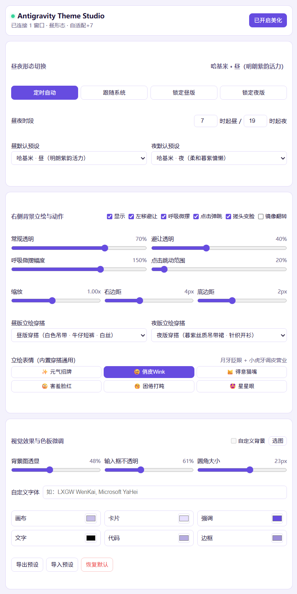

<div align="center">
  
  <h1>Antigravity Theme Studio</h1>
  <p><strong>专为 Antigravity Desktop 打造的二次元紫韵主题美化与 WebGL 动态立绘插件</strong></p>

  <p>
    
    
    
    
    <a href="LICENSE"></a>
  </p>

  <p>
    <a href="#-效果展示">效果对比</a> ·
    <a href="#-核心视觉与立绘特性">立绘与特性</a> ·
    <a href="#-快速安装">快速安装</a> ·
    <a href="#-使用方式">控制面板</a>
  </p>
</div>

---

## ✨ 效果展示

<table>
  <tr>
    <th width="50%">☀️ 昼形态 · 柔雾浅紫（白色花边兔女郎）</th>
    <th width="50%">🌙 夜形态 · 柔和暮紫（暮紫慵懒穿搭）</th>
  </tr>
  <tr>
    <td align="center"></td>
    <td align="center"></td>
  </tr>
</table>

<details>
<summary>👗 <strong>展开查看内置 3 套高清透明立绘穿搭（昼 / 夜可自由混搭）</strong></summary>
<br />

| 昼版 · 清新日常 | 夜版 · 暮紫慵懒 | 昼夜通用 · 白色花边兔女郎 |
| :---: | :---: | :---: |
|  |  |  |

</details>

---

## 🎨 核心视觉与立绘特性

| 模块 | 核心亮点 |
| :--- | :--- |
| **WebGL 动态交互立绘** | 由 `20×28` 顶点网格驱动，锁定面部五官不形变，提供**胸肩待机微呼吸 + 外侧发梢与猫尾柔风微摆**（`50%–200%` 幅度调节，后台自动休眠）。 |
| **精准命中与不挡操作** | 内置 `96×144` 透明通道命中图精确识别人物轮廓，**点击立绘任意部位触发局部果冻弹跳**（`10%–150%` 可调），鼠标完全穿透不拦截文字选中与点击。 |
| **自由构图与智能避让** | 支持缩放（`0.50x–1.60x`）、右边距/底边距微调、常规透明度、**水平镜像翻转**（羽化自适应）；展开右侧面板或窗口变窄时平滑左移并淡出避让。 |
| **昼夜双形态与 4 套预设** | 默认 `07:00–19:00` 柔雾浅紫昼版、`19:00–07:00` 柔和暮紫夜版，支持定时 / 跟随系统 / 手动锁定 / 一键还原，各预设色板独立微调互不串色。 |
| **全窗自定义画布背景** | 一键选取本地图片作为整窗背景（`10%–100%` 透显度调节），搭配毛玻璃底部输入栏、可调圆角（`4–36px`）与代码高亮配色。 |

---

## 📦 快速安装

### 方式一（推荐）：一键复制提示词给 Antigravity 自动安装

不想手动配置或敲命令时，点击代码块右上角 **Copy** 复制下面这段提示词，直接发给 Antigravity 对话即可自动完成安装或更新：

```text
请帮我安装或更新 GitHub 插件 https://github.com/happyday91/agy-theme-studio ：自动执行对应系统的一键安装脚本（Windows 运行 install.ps1，macOS/Linux 运行 install.sh）将其部署到 Antigravity 插件目录，完成后提醒我启用或重启生效。
```

<details>
<summary>💻 <strong>方式二：终端一行命令自动安装 / 更新（支持 Windows / macOS / Linux）</strong></summary>
<br />

无需手动查找插件目录；无论是否安装过 `git`，脚本都会自动克隆、拉取更新或走压缩包安装，且**不会覆盖 `sidecar_data` 个人配置**。

- **Windows（终端）**（兼容 CMD 与 PowerShell）：
  ```cmd
  powershell -NoProfile -ExecutionPolicy Bypass -Command "irm https://raw.githubusercontent.com/happyday91/agy-theme-studio/main/install.ps1 | iex"
  ```

- **macOS / Linux（终端）**：
  ```bash
  curl -fsSL https://raw.githubusercontent.com/happyday91/agy-theme-studio/main/install.sh | bash
  ```

</details>

> **启用生效**：安装完成后，在 Antigravity Desktop 的 **Plugins / Customizations** 管理页启用 **Antigravity Theme Studio**（或重启客户端即可生效）。

---

## 🛠️ 使用方式

### 1. 可视化控制面板（支持立绘智能左移避让）

在对话中打开 `[Theme Studio](sidecar://agy-theme-studio/theme_studio/)`（或在插件管理中打开面板），即可在自适应单页仪表盘中实时调节全部参数；展开面板时立绘会自动平滑左移淡出，不遮挡右侧操作：

<table>
  <tr>
    <th width="64%">整窗避让联动效果</th>
    <th width="36%">控制面板高清全览</th>
  </tr>
  <tr>
    <td align="center"></td>
    <td align="center"></td>
  </tr>
</table>

- **昼夜形态与预设**：切换定时 / 跟随系统 / 锁定昼夜 / 暂停还原，自定义起昼与起夜时间、默认昼夜预设。
- **右侧立绘与动作**：一键开关显示、左移避让、呼吸微摆、点击弹跳、镜像翻转；滑动调节常规/避让透明度、呼吸幅度、点击跳动范围、缩放与边距，并切换昼/夜穿搭。
- **视觉效果与色板**：开启自定义背景与选图，调整背景透显度、输入框不透明度、圆角大小与字体；逐项微调画布/卡片/强调/文字/代码/边框颜色，支持 JSON 预设导出、导入与恢复默认。

### 2. 顶部快捷自定义背景

- 点击对话窗口顶部右侧的 **「🖼 自定义背景」** 按钮即可快速开启/更换本地背景图（推荐 `16:9` 或 `16:10` 横屏图），并在面板或快捷入口调节背景透显度。

---

<div align="center">
  <sub>基于 <a href="LICENSE">MIT License</a> 开源 · Made for Antigravity Desktop</sub>
</div>
